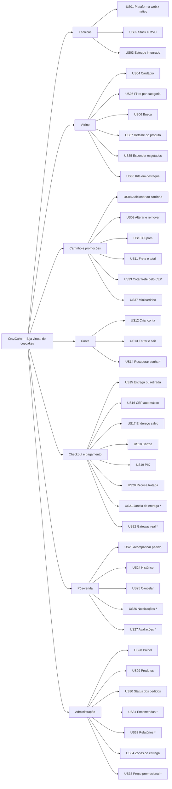

# Mapa de Afinidade, Backlog de Produto e Tarefas

> Os cartões estão detalhados em [02-historias-de-usuario.md](02-historias-de-usuario.md). Aqui eles aparecem agrupados por afinidade, priorizados, distribuídos em sprints e quebrados em tarefas. Para controlar o andamento, sugere-se um quadro Kanban no **GitHub Projects** (integrado ao repositório) ou no **Trello**, com as colunas *Backlog → Sprint → Fazendo → Revisão → Pronto*.

## 1. Mapa de afinidade

As histórias foram agrupadas em 7 eixos temáticos.

`*` indica história do backlog futuro (fora do MVP).

As histórias US33 a US38 entraram na revisão Kaizen do PIT II (evoluções a partir de situações comuns de e-commerce).

**Leitura do mapa:** o núcleo do negócio (vitrine → carrinho → checkout/pagamento → acompanhamento) concentra a maior parte dos pontos e da prioridade [A]. O eixo de administração é o que **evita a repetição do fracasso do app anterior**: sem estoque confiável e sem gestão de status, o cliente recebe promessas que a loja não cumpre.

## 2. Backlog de produto priorizado

A prioridade segue a escala do template, de **[A]** (essencial para lançar) a **[E]** (desejável). A ordem considera valor para o negócio, dependências técnicas e risco: os spikes vêm primeiro porque destravam o resto.

| Ordem | ID | História do usuário | Pontos | Prioridade | Tema | Sprint |
|---|---|---|---|---|---|---|
| 1 | US01 | Como equipe técnica, quero decidir entre web responsiva e app nativo | 2 | A | Técnicas | 0 |
| 2 | US02 | Como equipe técnica, quero definir stack e arquitetura MVC | 2 | A | Técnicas | 0 |
| 3 | US03 | Como dona da loja, quero o estoque do app refletindo a produção do dia | 2 | B | Técnicas | 0 |
| 4 | US04 | Como visitante, quero ver o cardápio com foto, preço e disponibilidade | 3 | A | Vitrine | 1 |
| 5 | US07 | Como cliente, quero ver ingredientes, alérgenos e disponibilidade do produto | 3 | A | Vitrine | 1 |
| 6 | US08 | Como visitante, quero adicionar ao carrinho sem login | 3 | A | Carrinho | 1 |
| 7 | US09 | Como cliente, quero alterar quantidades e remover itens | 2 | A | Carrinho | 1 |
| 8 | US12 | Como visitante, quero criar uma conta | 3 | A | Conta | 1 |
| 9 | US13 | Como cliente, quero entrar e sair | 2 | A | Conta | 1 |
| 10 | US05 | Como cliente, quero filtrar por categoria | 2 | B | Vitrine | 1 |
| 11 | US06 | Como cliente, quero buscar um sabor | 2 | B | Vitrine | 1 |
| 12 | US11 | Como cliente, quero ver frete e total antes de pagar | 2 | A | Carrinho | 2 |
| 13 | US15 | Como cliente, quero escolher entre entrega e retirada | 2 | A | Checkout | 2 |
| 14 | US18 | Como cliente, quero pagar com cartão com aprovação imediata | 5 | A | Checkout | 2 |
| 15 | US19 | Como cliente, quero pagar com PIX | 3 | A | Checkout | 2 |
| 16 | US20 | Como cliente, quero uma mensagem clara quando o cartão for recusado | 2 | A | Checkout | 2 |
| 17 | US16 | Como cliente, quero preencher o endereço pelo CEP | 2 | B | Checkout | 2 |
| 18 | US10 | Como cliente, quero aplicar um cupom de desconto | 3 | B | Carrinho | 2 |
| 19 | US17 | Como cliente recorrente, quero reutilizar um endereço salvo | 2 | C | Checkout | 2 |
| 20 | US30 | Como atendente, quero gerenciar o status dos pedidos | 5 | A | Administração | 3 |
| 21 | US29 | Como administradora, quero cadastrar e editar produtos | 5 | A | Administração | 3 |
| 22 | US23 | Como cliente, quero acompanhar o pedido por uma linha do tempo | 3 | A | Pós-venda | 3 |
| 23 | US28 | Como administradora, quero um painel com indicadores e estoque baixo | 3 | B | Administração | 3 |
| 24 | US24 | Como cliente, quero ver meu histórico de pedidos | 2 | B | Pós-venda | 3 |
| 25 | US25 | Como cliente, quero cancelar antes do preparo | 2 | B | Pós-venda | 3 |
| 26 | US33 | Como visitante, quero saber se a loja entrega no meu CEP, o valor e o prazo antes de criar conta | 3 | A | Carrinho | 5 |
| 27 | US34 | Como administradora, quero cadastrar e editar zonas de entrega e frete | 5 | A | Administração | 5 |
| 28 | US35 | Como cliente, quero ver na vitrine só o que dá para comprar hoje | 1 | B | Vitrine | 5 |
| 29 | US36 | Como visitante, quero identificar rapidamente as caixas e kits para presente | 2 | B | Vitrine | 5 |
| 30 | US37 | Como cliente, quero um minicarrinho para conferir o carrinho sem sair da página | 3 | B | Carrinho | 5 |
| 31 | US14 | Como cliente, quero recuperar minha senha por e-mail | 3 | C | Conta | Futuro |
| 32 | US22 | Como dona da loja, quero integrar um gateway de pagamento real | 5 | C | Checkout | Futuro |
| 33 | US32 | Como administradora, quero relatórios de vendas | 3 | C | Administração | Futuro |
| 34 | US38 | Como administradora, quero programar preço promocional com início e fim | 3 | C | Administração | Futuro |
| 35 | US21 | Como cliente, quero agendar uma janela de entrega | 3 | D | Checkout | Futuro |
| 36 | US26 | Como cliente, quero notificações de status no WhatsApp ou por e-mail | 3 | D | Pós-venda | Futuro |
| 37 | US31 | Como cliente, quero encomendas personalizadas para festas | 5 | D | Administração | Futuro |
| 38 | US27 | Como cliente, quero avaliar os sabores que comprei | 2 | E | Pós-venda | Futuro |
| | | **Total** | **108** | | | |

## 3. Plano de sprints (2 semanas cada)

| Sprint | Objetivo | Histórias | Pontos |
|---|---|---|---|
| **0** — Fundação | Decisões técnicas, repositório, banco, migrações, seed e esqueleto MVC | US01, US02, US03 | 6 |
| **1** — Vitrine e conta | O visitante navega pelo cardápio, monta o carrinho e cria a conta | US04, US05, US06, US07, US08, US09, US12, US13 | 20 |
| **2** — Checkout e pagamento | O cliente fecha a compra com entrega ou retirada, cupom, PIX ou cartão | US10, US11, US15, US16, US17, US18, US19, US20 | 21 |
| **3** — Pós-venda e administração | A loja opera os pedidos e o cliente acompanha | US23, US24, US25, US28, US29, US30 | 20 |
| **4** — Validação | Testes com 5 usuários, correções, laudo de qualidade e vídeo (Situação 3 do PIT II) | Correções vindas do feedback | — |
| **5** — Evoluções | Frete por zona com cotação pública, vitrine sem esgotados, kits em destaque e minicarrinho (revisão Kaizen) | US33, US34, US35, US36, US37 | 14 |

A velocidade planejada é de cerca de 20 pontos por sprint. O MVP original (67 pontos) cabe em 4 sprints de desenvolvimento; a sprint 5 incorporou as evoluções (14 pontos), totalizando 81 pontos entregues. O backlog futuro (27 pontos) fica para os próximos ciclos, já com a loja vendendo.

**Definição de Pronto (DoD):** critérios de aceitação atendidos; regras de negócio cobertas por teste automatizado (`npm test`); `npm run lint`, `npm run typecheck` e `npm run build` sem erros; mensagens de erro revisadas; tela testada em largura de celular (360 px).

## 4. Decomposição em tarefas

As tarefas foram estimadas em horas, entre 2 e 12 h cada, como recomenda o material do curso.

### US02 — Definir stack e arquitetura MVC
| Tarefa | Estimativa |
|---|---|
| T1. Criar o projeto Next.js + TypeScript + Tailwind e as pastas `models/`, `controllers/`, `app/` | 3 h |
| T2. Configurar Drizzle, PGlite (dev) e PostgreSQL (produção) em `src/models/db/client.ts` | 4 h |
| T3. Escrever o README com a arquitetura e como rodar | 2 h |

### US03 — Estratégia de estoque integrado
| Tarefa | Estimativa |
|---|---|
| T1. Modelar a coluna `estoque` com restrição `CHECK (estoque >= 0)` em `src/models/db/schema.ts` | 2 h |
| T2. Implementar a baixa condicional (`UPDATE … WHERE estoque >= qtd`) na transação do pedido | 4 h |
| T3. Teste de integração: compra acima do estoque e devolução no cancelamento | 3 h |

### US04 — Ver o cardápio na vitrine
| Tarefa | Estimativa |
|---|---|
| T1. Serviço `listarProdutosVitrine` (somente ativos, destaques primeiro) em `catalogo.service.ts` | 3 h |
| T2. Componente `ProdutoCard` com selos de destaque e de "Últimas N" | 4 h |
| T3. Página `src/app/page.tsx` com banner, grade responsiva e estado vazio | 4 h |
| T4. Testes de integração da vitrine | 2 h |

### US08 / US09 — Carrinho
| Tarefa | Estimativa |
|---|---|
| T1. `CarrinhoProvider` com persistência em localStorage e avisos (toasts) | 5 h |
| T2. Endpoint `POST /api/carrinho/precificar` e serviço `precificarCarrinho` (reprecifica e aponta problemas) | 6 h |
| T3. Tela do carrinho com alteração de quantidade, remoção e destaque de problemas | 6 h |
| T4. Testes: esgotado, acima do estoque, limite de 24 | 3 h |

### US10 — Aplicar cupom
| Tarefa | Estimativa |
|---|---|
| T1. Tabela `cupons` e seed (`BEMVINDO10`, `DOCE5`, `NATAL2025`) | 2 h |
| T2. Regra pura `calcularDescontoCupom` (validade, mínimo, teto) | 3 h |
| T3. Campo de cupom no carrinho com mensagens de sucesso e erro | 3 h |
| T4. Testes unitários do cupom | 2 h |

### US12 / US13 — Conta
| Tarefa | Estimativa |
|---|---|
| T1. Schemas Zod de cadastro e login com política de senha (RN10) | 3 h |
| T2. `auth.service.ts` com bcrypt e e-mail único | 3 h |
| T3. Sessão JWT em cookie httpOnly (`src/lib/sessao.ts`) | 4 h |
| T4. Telas Entrar e Cadastro com erros por campo e redirecionamento seguro (`?voltar=`) | 5 h |
| T5. Testes de cadastro duplicado e senha errada | 2 h |

### US18 / US19 / US20 — Pagamento
| Tarefa | Estimativa |
|---|---|
| T1. Regras puras `luhnValido`, `validadeCartaoOk` e `processarCartaoSimulado` em `pagamento.ts` | 4 h |
| T2. Geração do PIX copia-e-cola simulado | 2 h |
| T3. Transação `criarPedido`: reprecificar → baixar estoque → autorizar cartão → gravar pedido, itens, pagamento e histórico | 10 h |
| T4. Tela de checkout com seleção de método, máscaras e mensagens de recusa | 8 h |
| T5. Endpoint `confirmar-pix` e botão de simulação na tela do pedido | 3 h |
| T6. Testes: aprovado, recusado com rollback, PIX pendente → pago | 4 h |

### US16 — CEP automático
| Tarefa | Estimativa |
|---|---|
| T1. Integração com o ViaCEP no front (busca ao sair do campo) | 3 h |
| T2. Tratamento de CEP inexistente e de serviço fora do ar (preenchimento manual) | 2 h |
| T3. Validação de CEP e UF no `enderecoSchema` | 2 h |

### US23 / US30 — Acompanhamento e gestão de status
| Tarefa | Estimativa |
|---|---|
| T1. Máquina de estados `proximosStatusPossiveis` e `validarTransicao` | 4 h |
| T2. Serviço `mudarStatusPedido` (histórico, devolução de estoque, aprovação do PIX) | 5 h |
| T3. Componente de linha do tempo e selos de status | 4 h |
| T4. Tela admin de pedidos com filtro por status e botões só das transições válidas | 6 h |
| T5. Testes do fluxo completo até "Entregue" e das transições inválidas | 3 h |

### US29 — Produtos (admin)
| Tarefa | Estimativa |
|---|---|
| T1. `admin.service.ts`: criar e atualizar com slug único | 4 h |
| T2. Formulário de produto com preço em reais ("12,50") e seleção de imagem | 6 h |
| T3. Lista de produtos com destaque de estoque | 3 h |
| T4. Proteção de rota (layout admin e `exigirAdmin`) | 2 h |

### US33 / US34 — Cotação de frete e zonas de entrega
| Tarefa | Estimativa |
|---|---|
| T1. Tabela `zonas_entrega` (faixa de CEP, valor, frete grátis, prazo, ativo) e coluna `pedidos.zona_entrega_id`; migração `0001_zonas_de_entrega.sql` e seed com 3 zonas | 3 h |
| T2. Regras puras `encontrarZona` (faixa mais específica) e `calcularFrete` por zona em `regras/pedido.ts` | 3 h |
| T3. `frete.service.ts` (cotação e CRUD de zonas) e `cep.service.ts` (ViaCEP com BrasilAPI de reserva) | 5 h |
| T4. Endpoints `GET /api/frete`, `GET /api/cep/{cep}` e `/api/admin/zonas-entrega` | 3 h |
| T5. Componente `CotacaoFrete` no produto e no carrinho, com CEP salvo no navegador | 5 h |
| T6. Checkout: frete da zona no resumo e bloqueio de entrega fora da área (`ENTREGA_INDISPONIVEL`) | 4 h |
| T7. Telas admin de zonas (lista e formulário com validação de faixa) | 6 h |
| T8. Testes: zona mais específica, CEP fora da área, criar zona, faixa invertida, frete gravado no pedido | 4 h |

### US35 / US36 — Vitrine sem esgotados e kits em destaque
| Tarefa | Estimativa |
|---|---|
| T1. Filtrar `estoque > 0` em `listarProdutosVitrine` mantendo a página direta do produto | 2 h |
| T2. Arte das caixas mostrando os cupcakes (`caixa.svg`, `kit-festa.svg`) e selo "Kit para presentear" | 4 h |
| T3. Reordenar categorias (Caixas e kits em 2º) e teste de esgotado oculto | 2 h |

### US37 — Minicarrinho
| Tarefa | Estimativa |
|---|---|
| T1. Estado `miniAberto` no `CarrinhoProvider` e abertura automática ao adicionar | 2 h |
| T2. Componente `MiniCarrinho` (gaveta lateral, quantidades, subtotal, botões) | 5 h |
| T3. Acessibilidade: `role="dialog"`, foco no botão fechar, Esc e clique fora fecham, rolagem do fundo travada | 3 h |
