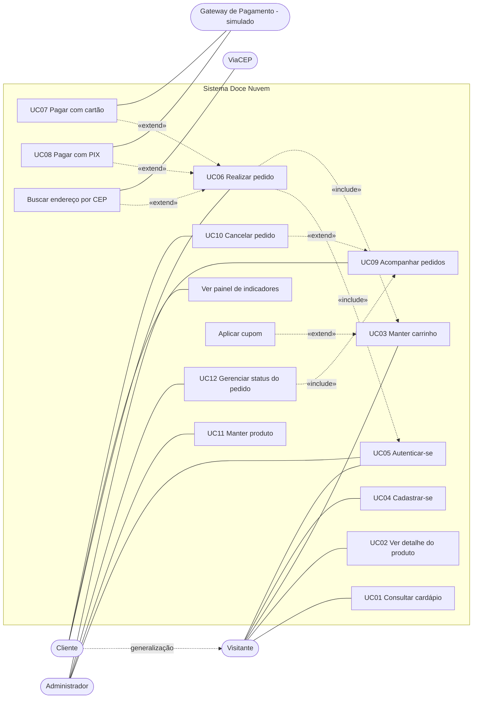

# Casos de Uso — Doce Nuvem Cupcakes

> Documento revisado no PIT II. As referências a telas (TELA-xx) e regras de negócio (RNxx) seguem a mesma numeração usada nas histórias de usuário, nos wireframes e no código-fonte.

## 1. Atores

| Ator | Tipo | Descrição |
|---|---|---|
| **Visitante** | Primário | Pessoa não autenticada que navega pelo cardápio e monta o carrinho |
| **Cliente** | Primário | Visitante autenticado (especialização do Visitante) que compra, paga e acompanha pedidos |
| **Administrador** | Primário | Dona da loja, confeiteira ou atendente com papel ADMIN; mantém produtos e opera os pedidos |
| **Gateway de Pagamento (simulado)** | Secundário | Autoriza o cartão e confirma o PIX. Nesta versão é simulado em `src/models/regras/pagamento.ts` |
| **ViaCEP** | Secundário | Serviço público que devolve o endereço a partir do CEP |

## 2. Diagrama de caso de uso geral

**Como ler:** o Cliente herda tudo o que o Visitante pode fazer. *Realizar pedido* **inclui** autenticação e carrinho (são obrigatórios). Pagar com cartão, pagar com PIX e buscar CEP **estendem** o pedido conforme a escolha do cliente.

## 3. Lista de casos de uso

| ID | Caso de uso | Ator principal | Histórias relacionadas | Telas |
|---|---|---|---|---|
| UC01 | Consultar cardápio (filtrar e buscar) | Visitante | US04, US05, US06 | TELA-01 |
| UC02 | Ver detalhe do produto | Visitante | US07 | TELA-02, TELA-14 |
| UC03 | Manter carrinho (adicionar, alterar, remover, aplicar cupom) | Visitante | US08, US09, US10, US11 | TELA-03 |
| UC04 | Cadastrar-se | Visitante | US12 | TELA-05 |
| UC05 | Autenticar-se (entrar e sair) | Visitante / Administrador | US13 | TELA-04 |
| UC06 | Realizar pedido (checkout) | Cliente | US15, US16, US17 | TELA-06, TELA-07 |
| UC07 | Pagar com cartão | Cliente | US18, US20 | TELA-06 |
| UC08 | Pagar com PIX | Cliente | US19 | TELA-07 |
| UC09 | Acompanhar pedidos | Cliente | US23, US24 | TELA-07, TELA-08 |
| UC10 | Cancelar pedido | Cliente | US25 | TELA-07 |
| UC11 | Manter produto | Administrador | US29 | TELA-12, TELA-13 |
| UC12 | Gerenciar status do pedido | Administrador | US28, US30 | TELA-09, TELA-10, TELA-11 |

**Telas referenciadas:** TELA-01 Vitrine · TELA-02 Detalhe do produto · TELA-03 Carrinho · TELA-04 Entrar · TELA-05 Cadastro · TELA-06 Checkout · TELA-07 Pedido (confirmação/acompanhamento) · TELA-08 Meus pedidos · TELA-09 Painel admin · TELA-10 Pedidos admin · TELA-11 Detalhe do pedido admin · TELA-12 Produtos admin · TELA-13 Formulário de produto · TELA-14 Página não encontrada · TELA-15 Erro inesperado.

---

## 4. Casos de uso expandidos

### UC06 — Realizar pedido (checkout)

**Nome:** Realizar pedido
**Identificador:** UC06
**Descrição:** O cliente transforma o carrinho em um pedido, escolhendo a forma de recebimento e de pagamento. O servidor reprecifica tudo, reserva o estoque e registra o pedido.
**Atores:** Cliente (principal); Gateway de Pagamento e ViaCEP (secundários).
**Pré-condições:** o carrinho tem ao menos 1 item; o cliente está autenticado (UC05).
**Pós-condições:** pedido gravado com itens, pagamento e histórico; estoque baixado; carrinho esvaziado. Com cartão aprovado, o status é *Pago*; com PIX, o status é *Aguardando pagamento*.

**Curso básico de ação:**
1. O caso de uso começa quando o cliente clica em "Finalizar compra" na TELA-03 – Carrinho.
2. O sistema verifica a sessão e exibe a TELA-06 – Checkout com o resumo de valores calculado no servidor (RN01, RN02, RN05). <Curso alternativo Alfa>
3. O cliente escolhe **Entrega** ou **Retirada na loja**. <Curso alternativo Beta>
4. O sistema apresenta os endereços salvos do cliente; se não houver, apresenta o formulário de endereço.
5. O cliente seleciona um endereço salvo ou informa um novo; ao digitar o CEP, o sistema consulta o ViaCEP e preenche rua, bairro, cidade e UF. <Curso alternativo Gama>
6. O sistema recalcula o frete conforme o tipo de recebimento (RN02).
7. O cliente escolhe a forma de pagamento: cartão (UC07) ou PIX (UC08).
8. O cliente informa uma observação opcional e clica em confirmar.
9. O sistema valida os dados de entrada (formato de CEP, UF, cartão, limite de 24 por item – RN04). <Curso alternativo Delta>
10. O sistema, em uma única transação, reprecifica o carrinho, valida o cupom (RN05) e baixa o estoque de cada item de forma condicional (RN03). <Curso alternativo Épsilon>
11. O sistema processa o pagamento escolhido (UC07 ou UC08) (RN06).
12. O sistema grava o pedido, os itens (com nome e preço da época), o pagamento e o histórico de status (RN07); se solicitado, salva o endereço.
13. O sistema esvazia o carrinho e exibe a TELA-07 – Pedido com a mensagem "Pedido #N recebido!".
14. O caso de uso termina.

**Curso alternativo Alfa:** cliente não autenticado.
- Alfa2.1: O sistema redireciona para a TELA-04 – Entrar com `?voltar=/checkout`.
- Alfa2.2: O cliente se autentica (UC05) ou se cadastra (UC04).
- Alfa2.3: O caso de uso retorna ao passo 2.

**Curso alternativo Beta:** retirada na loja.
- Beta3.1: O sistema oculta o endereço e exibe o endereço e o horário da loja.
- Beta3.2: O frete é zerado (RN02) e o caso de uso segue no passo 7.

**Curso alternativo Gama:** CEP não encontrado ou ViaCEP indisponível.
- Gama5.1: O sistema exibe "CEP não encontrado. Confira ou preencha o endereço manualmente." (se o ViaCEP estiver fora do ar, apenas não preenche).
- Gama5.2: O cliente preenche o endereço manualmente e o caso de uso segue no passo 6.

**Curso alternativo Delta:** dados inválidos.
- Delta9.1: O sistema devolve erro de validação com a mensagem associada a cada campo (ex.: "UF deve ter 2 letras.").
- Delta9.2: Os campos com erro ficam marcados (`aria-invalid`) e o caso de uso retorna ao passo 3.

**Curso alternativo Épsilon:** item esgotado, produto desativado ou cupom inválido durante a finalização.
- Épsilon10.1: O sistema desfaz a transação; nada é gravado e o estoque não muda.
- Épsilon10.2: O sistema exibe a mensagem (ex.: "Frutas Vermelhas acabou de esgotar. Ajuste seu carrinho.") com o link "Voltar ao carrinho para ajustar".
- Épsilon10.3: O caso de uso termina.

---

### UC04 — Cadastrar-se

**Nome:** Cadastrar-se
**Identificador:** UC04
**Descrição:** O visitante cria uma conta de cliente e já sai autenticado.
**Atores:** Visitante.
**Pré-condições:** o visitante não está autenticado.
**Pós-condições:** usuário gravado com papel CLIENTE, e-mail em minúsculas e senha com hash bcrypt; sessão criada.

**Curso básico de ação:**
1. O caso de uso começa quando o visitante clica em "Cadastre-se" na TELA-04 – Entrar (ou acessa a TELA-05 – Cadastro diretamente).
2. O sistema exibe a TELA-05 com os campos nome completo, e-mail, celular (opcional), senha e confirmação de senha, e a dica "Mínimo de 8 caracteres, com letras e números".
3. O visitante preenche os campos e clica em "Criar conta".
4. O sistema valida o formato dos campos e a política de senha (RN10). <Curso alternativo Alfa>
5. O sistema verifica se o e-mail já existe. <Curso alternativo Beta>
6. O sistema grava o usuário e cria a sessão (cookie httpOnly com validade de 7 dias).
7. O sistema redireciona o visitante, agora cliente, para a página de origem (parâmetro `voltar`, apenas caminhos internos) ou para a TELA-01.
8. O caso de uso termina.

**Curso alternativo Alfa:** dados inválidos.
- Alfa4.1: O sistema exibe a mensagem abaixo de cada campo com erro (ex.: "A senha deve conter pelo menos um número.", "As senhas não conferem.", "Telefone inválido. Ex.: (11) 91234-5678").
- Alfa4.2: O caso de uso retorna ao passo 3.

**Curso alternativo Beta:** e-mail já cadastrado.
- Beta5.1: O sistema exibe "Já existe uma conta com este e-mail. Tente entrar ou recuperar a senha.".
- Beta5.2: O visitante pode seguir para a TELA-04 pelo link "Entrar"; o caso de uso termina.

---

### UC08 — Pagar com PIX

**Nome:** Pagar com PIX
**Identificador:** UC08
**Descrição:** O cliente recebe um código PIX copia-e-cola para o pedido e, ao pagar, o pedido é liberado para preparo.
**Atores:** Cliente (principal); Gateway de Pagamento – simulado (secundário).
**Pré-condições:** o cliente escolheu PIX no UC06; o pedido foi criado com status *Aguardando pagamento*, pagamento PENDENTE e estoque reservado.
**Pós-condições:** pagamento APROVADO, pedido com status *Pago* e o registro "PIX confirmado" no histórico.

**Curso básico de ação:**
1. O caso de uso começa quando o UC06 termina com pagamento por PIX.
2. O sistema exibe a TELA-07 – Pedido com o bloco "Pague com PIX", contendo o código copia-e-cola (valor e número do pedido) e os botões "Copiar código" e "Simular pagamento confirmado".
3. O cliente clica em "Copiar código" e o sistema confirma com o aviso "Código PIX copiado".
4. O cliente paga no aplicativo do banco.
5. O Gateway confirma o pagamento. Na demonstração, o cliente clica em "Simular pagamento confirmado" (RN06).
6. O sistema verifica se o pedido pertence ao cliente, se é PIX e se está *Aguardando pagamento*. <Curso alternativo Alfa>
7. O sistema muda o status para *Pago* (RN07), aprova o pagamento e registra o histórico.
8. O sistema atualiza a TELA-07: o bloco PIX some e a linha do tempo mostra "Pagamento aprovado".
9. O caso de uso termina.

**Curso alternativo Alfa:** pedido não está mais aguardando PIX (já pago ou cancelado).
- Alfa6.1: O sistema responde "Este pedido não está aguardando pagamento via PIX.".
- Alfa6.2: O caso de uso termina sem alterações.

**Curso alternativo Beta:** o cliente desiste de pagar.
- Beta4.1: O cliente aciona o UC10 – Cancelar pedido.
- Beta4.2: O estoque volta (RN03), o pagamento fica como não concluído e o caso de uso termina.

---

### UC12 — Gerenciar status do pedido

**Nome:** Gerenciar status do pedido
**Identificador:** UC12
**Descrição:** O administrador acompanha os pedidos e avança cada um pelas etapas de produção e entrega, respeitando a máquina de estados.
**Atores:** Administrador.
**Pré-condições:** o administrador está autenticado com papel ADMIN.
**Pós-condições:** o status do pedido foi alterado, há um novo registro no histórico (com observação opcional) e o cliente vê a mudança na TELA-07.

**Curso básico de ação:**
1. O caso de uso começa quando o administrador acessa a TELA-09 – Painel admin, que mostra pedidos em aberto, pedidos pagos, faturamento e estoque baixo.
2. O administrador abre "Pedidos" e o sistema exibe a TELA-10 – Pedidos admin, com filtro por situação.
3. O administrador filtra por uma situação (ex.: "Pagamento aprovado") e escolhe um pedido.
4. O sistema exibe a TELA-11 – Detalhe do pedido admin, com itens, cliente, endereço ou retirada, pagamento, linha do tempo e **apenas os botões das próximas etapas válidas** (RN07). <Curso alternativo Alfa>
5. O administrador informa uma observação opcional (ex.: "Forno 2") e clica na próxima etapa (ex.: "Marcar como Em preparo").
6. O sistema valida a transição. <Curso alternativo Beta>
7. O sistema grava o novo status e o histórico e exibe o aviso de sucesso.
8. O administrador repete os passos 5 a 7 até *Entregue*: para entrega, Em preparo → Saiu para entrega → Entregue; para retirada, Em preparo → Pronto para retirada → Entregue.
9. O caso de uso termina.

**Curso alternativo Alfa:** pedido em estado final.
- Alfa4.1: O sistema exibe "Este pedido está finalizado. Não há próximas etapas.".
- Alfa4.2: O caso de uso termina.

**Curso alternativo Beta:** transição inválida (ex.: requisição direta à API de *Pago* para *Entregue*).
- Beta6.1: O sistema recusa com "Não é possível mudar o pedido de 'Pagamento aprovado' para 'Entregue'." (HTTP 409).
- Beta6.2: O caso de uso retorna ao passo 4.

**Curso alternativo Delta:** cancelamento pela loja.
- Delta5.1: O administrador clica em "Cancelar pedido" e o sistema pede confirmação.
- Delta5.2: O sistema devolve os itens ao estoque (RN03), marca como não concluído o pagamento que estava pendente e registra *Cancelado*.
- Delta5.3: O caso de uso termina.

**Curso alternativo Gama:** usuário sem papel ADMIN.
- Gama1.1: O sistema redireciona para a TELA-01 (ou para a TELA-04, se não estiver autenticado); a API responde 403 "Acesso restrito à administração da loja.".

---

### UC11 — Manter produto

**Nome:** Manter produto
**Identificador:** UC11
**Descrição:** O administrador cadastra e edita os produtos do cardápio, controlando preço, estoque e visibilidade.
**Atores:** Administrador.
**Pré-condições:** o administrador está autenticado com papel ADMIN; existem categorias cadastradas.
**Pós-condições:** produto gravado com slug único; se estiver ativo, aparece na vitrine (RN09).

**Curso básico de ação:**
1. O caso de uso começa quando o administrador acessa a TELA-12 – Produtos admin, que lista nome, categoria, preço, estoque (com destaque para estoque baixo ou zerado) e situação.
2. O administrador clica em "+ Novo produto" ou em "Editar". <Curso alternativo Alfa>
3. O sistema exibe a TELA-13 – Formulário de produto (vazio ou preenchido).
4. O administrador informa nome, categoria, preço em reais (ex.: "12,50"), estoque, descrição, ingredientes, imagem e as opções "Ativo" e "Destaque".
5. O administrador clica em "Salvar".
6. O sistema converte o preço para centavos (RN01) e valida os campos. <Curso alternativo Beta>
7. O sistema gera o slug a partir do nome (sem acentos), garantindo que seja único. <Curso alternativo Delta>
8. O sistema grava o produto, exibe "Produto cadastrado" (ou "Produto atualizado") e retorna à TELA-12.
9. O caso de uso termina.

**Curso alternativo Alfa:** produto inexistente.
- Alfa2.1: Ao acessar a edição de um ID inexistente, o sistema exibe a TELA-14 – Página não encontrada.

**Curso alternativo Beta:** dados inválidos.
- Beta6.1: O sistema exibe as mensagens nos campos (ex.: "Informe um preço válido, ex.: 12,50", "O estoque não pode ser negativo.", "Selecione uma categoria.", "A descrição deve ter pelo menos 10 caracteres.").
- Beta6.2: O caso de uso retorna ao passo 4.

**Curso alternativo Delta:** nome igual ao de outro produto.
- Delta7.1: O sistema acrescenta um sufixo numérico ao slug (ex.: `red-velvet-2`) e o caso de uso segue no passo 8.

**Curso alternativo Épsilon:** retirar produto da venda.
- Épsilon4.1: O administrador desmarca "Ativo". Produtos não são excluídos, para preservar o histórico dos pedidos.
- Épsilon4.2: Após salvar, o produto some da vitrine e é removido automaticamente dos carrinhos na próxima precificação.

---

### UC10 — Cancelar pedido

**Nome:** Cancelar pedido
**Identificador:** UC10
**Descrição:** O cliente cancela um pedido que ainda não entrou em preparo.
**Atores:** Cliente.
**Pré-condições:** o cliente está autenticado e é dono do pedido; o pedido está *Aguardando pagamento* ou *Pago* (RN08).
**Pós-condições:** pedido *Cancelado*, estoque devolvido (RN03) e histórico registrado como "Cancelado pelo cliente".

**Curso básico de ação:**
1. O caso de uso começa quando o cliente abre a TELA-07 de um pedido elegível e clica em "Cancelar pedido".
2. O sistema exibe a confirmação "Tem certeza que deseja cancelar o pedido #N?".
3. O cliente confirma clicando em "Sim, cancelar". <Curso alternativo Alfa>
4. O sistema verifica a regra RN08. <Curso alternativo Beta>
5. O sistema cancela o pedido, devolve o estoque e marca como não concluído o pagamento pendente, se houver.
6. O sistema exibe o aviso "Pedido cancelado" e atualiza a linha do tempo.
7. O caso de uso termina.

**Curso alternativo Alfa:** o cliente desiste.
- Alfa3.1: O cliente clica em "Manter pedido"; a confirmação fecha e o caso de uso termina.

**Curso alternativo Beta:** o pedido já entrou em preparo (alteração feita pela loja enquanto a tela estava aberta).
- Beta4.1: O sistema exibe "Seu pedido já está em preparo e não pode mais ser cancelado pelo app. Fale com a loja.".
- Beta4.2: O caso de uso termina sem alterações.
