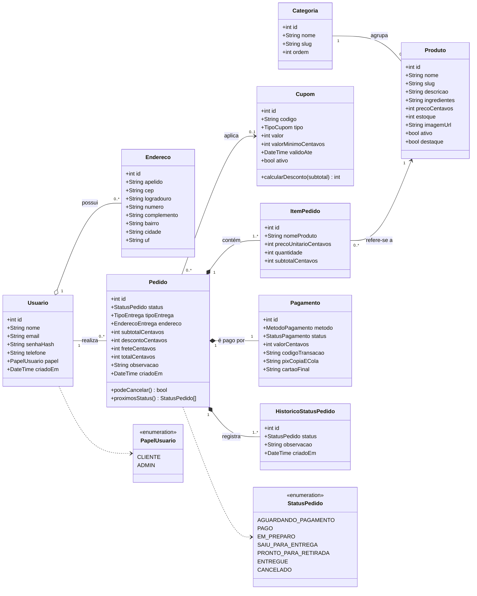
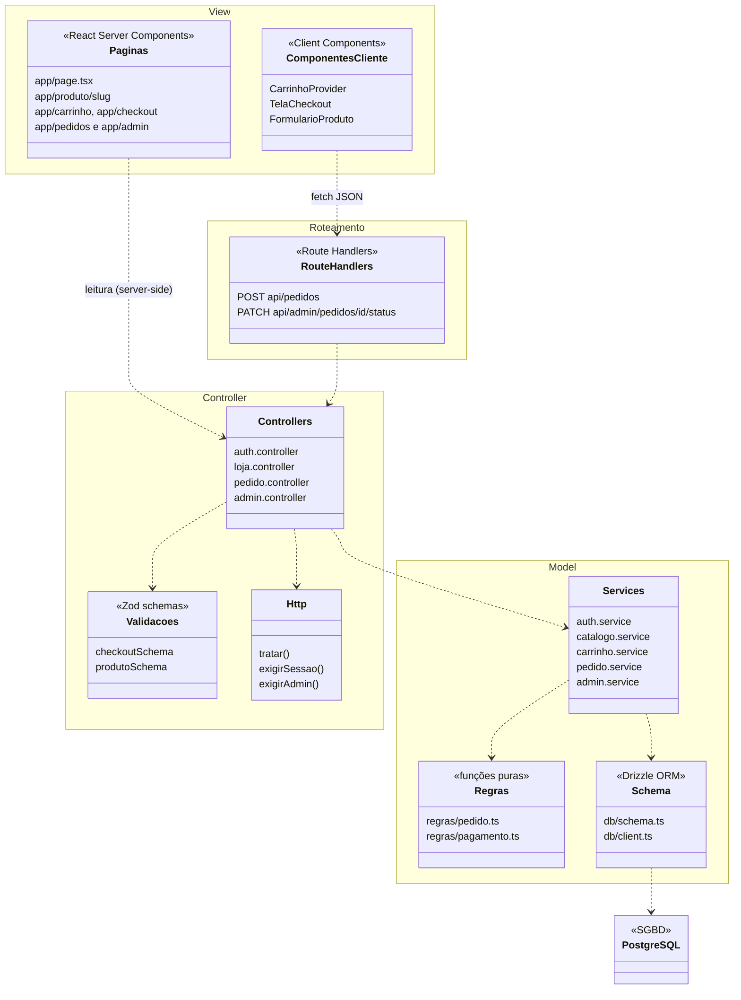
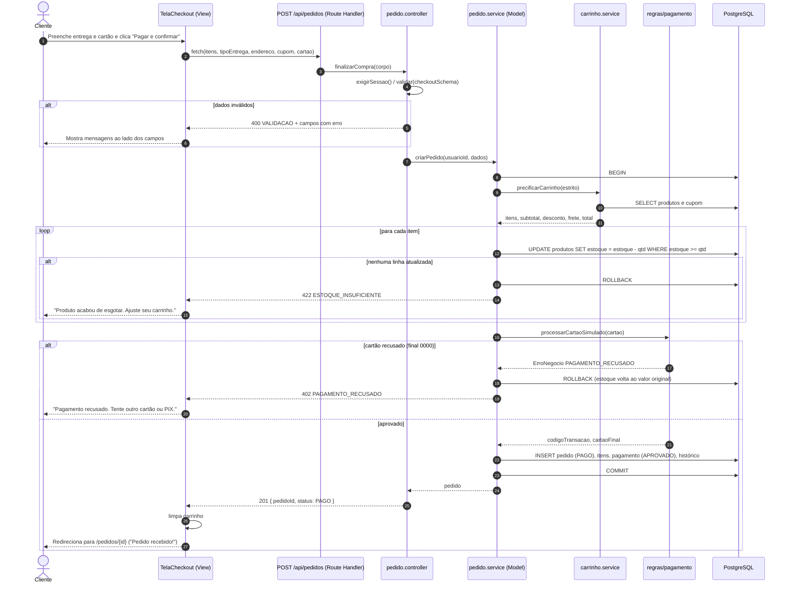
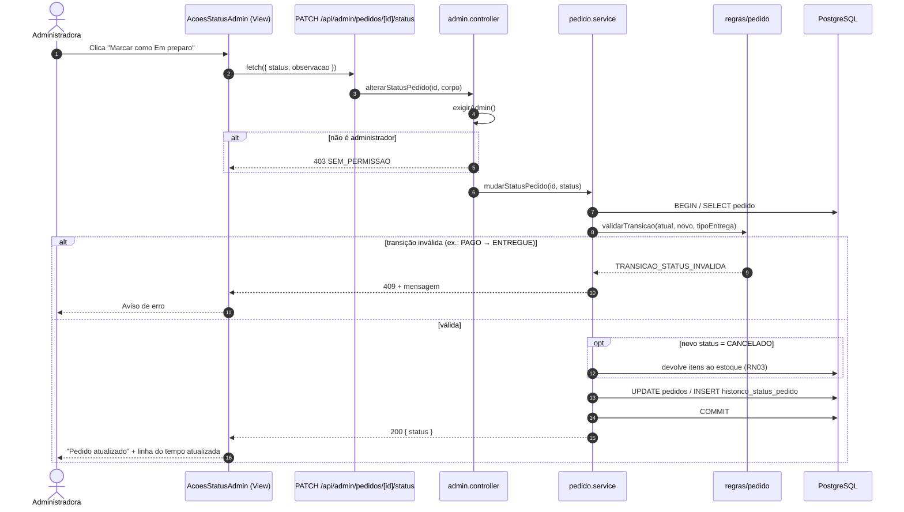
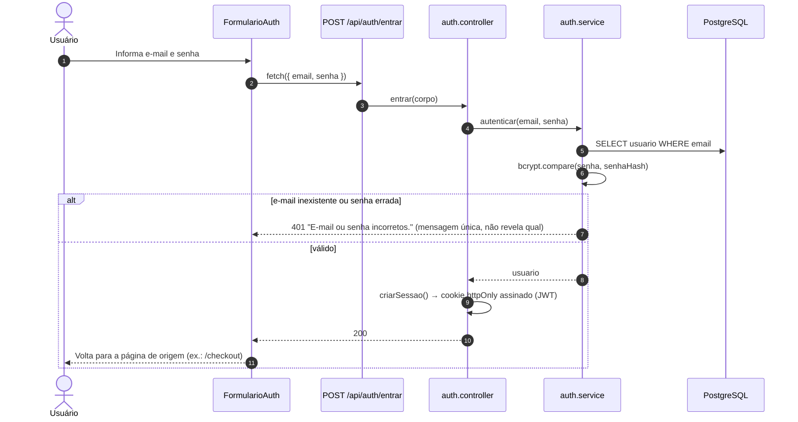
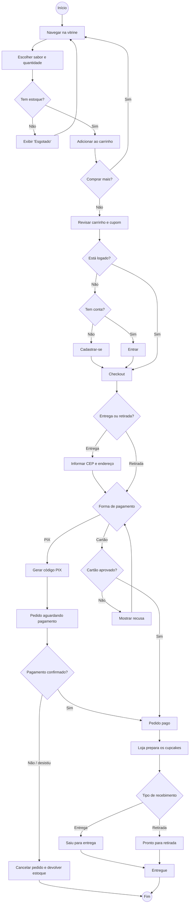
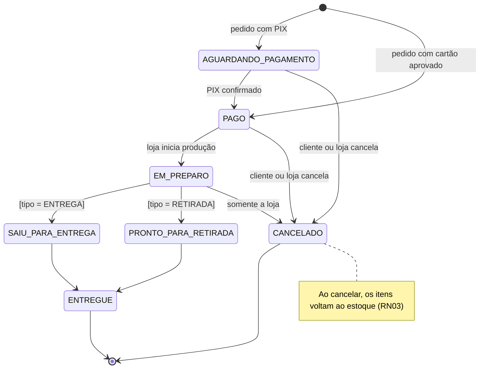

# 5. Diagramas UML

> Diagramas feitos em **Mermaid**, que o GitHub desenha automaticamente. O texto-fonte fica versionado junto ao código, então qualquer mudança no modelo aparece no histórico do Git. Os diagramas de caso de uso estão em `04-casos-de-uso.md`.

## 5.1 Diagrama de classes de domínio (persistência)

Representa as entidades persistidas e seus relacionamentos. Os atributos seguem o modelo físico (`src/models/db/schema.ts`). Valores monetários são inteiros em centavos (RN01).

**Decisões de modelagem**

- **Composição** (`*--`) entre Pedido e ItemPedido/Pagamento/Histórico: essas partes não existem sem o pedido (no banco, `ON DELETE CASCADE`).
- **Agregação** (`o--`) entre Usuário e Endereço: o endereço pertence ao usuário, mas o pedido guarda uma **cópia** do endereço, então apagar o endereço não afeta pedidos antigos.
- **Associação** entre ItemPedido e Produto: o item mantém o nome e o preço do momento da compra (snapshot), mas continua ligado ao produto para relatórios.

## 5.2 Diagrama de classes da arquitetura (MVC)

Mostra como o código está organizado em camadas e as dependências permitidas entre pacotes. Não há dependência circular: a View só fala com o Controller (direto ou via API), e só o Model acessa o banco.

## 5.3 Diagrama de sequência — Finalizar compra com cartão

Cenário principal e cenários alternativos (cartão recusado e estoque esgotado durante a compra).

## 5.4 Diagrama de sequência — Administradora avança o status do pedido

## 5.5 Diagrama de sequência — Login

## 5.6 Diagrama de atividades — Processo de compra

## 5.7 Diagrama de máquina de estados — Pedido (RN07)

A tabela de transições implementada está em `src/models/regras/pedido.ts` (`TRANSICOES`) e é coberta pelos testes de `tests/unit/regras-pedido.test.ts`.
