# 6. IHC: interface, navegação e protótipos

> Revisão da IHC do PIT I, incrementada até virar a interface real do sistema. Inclui princípios de design aplicados, mapa conceitual, mapa navegacional, especificação das telas (campos, validações e mensagens), wireframes de baixa fidelidade e mockups de alta fidelidade capturados da aplicação.

## 6.1 Princípios de design aplicados

| Princípio (material do curso) | Como foi aplicado |
|---|---|
| **Clara** | Linguagem do cliente ("Como quer receber?", "Finalizar compra"), preço sempre em destaque, total exibido antes de pagar |
| **Consistente** | Mesmos componentes em todas as telas: botão primário azul-marinho, secundário com contorno, erros em vermelho abaixo do campo |
| **Simples / divulgação progressiva** | O checkout mostra campos de endereço só para entrega e campos de cartão só quando o cartão é escolhido |
| **Controlada pelo usuário** | O cliente decide quando aplicar cupom, pode remover itens e cupom a qualquer momento e cancelar o pedido antes do preparo |
| **Direta** | Adicionar ao carrinho atualiza o contador do cabeçalho na hora e mostra aviso "1× Chocolate Belga adicionado" |
| **Empática e reversível** | Cancelamento pede confirmação; o carrinho fica salvo no navegador mesmo se a página falhar; mensagens explicam o que fazer em seguida |
| **Dá resposta (feedback)** | Botões mostram "Processando…", avisos *toast* em `aria-live`, linha do tempo do pedido |
| **Esteticamente agradável** | Paleta da marca (azul-marinho + laranja estrela sobre creme), tipografia arredondada (Nunito), ilustrações de cupcake |

### Identidade visual


O logo é um cupcake com uma **estrela laranja em traço contínuo** no lugar da cereja, uma homenagem à estrela da Universidade Cruzeiro do Sul. O nome **CruzCake** junta "Cruz" (Cruzeiro) e "Cake".

| Elemento | Valor |
|---|---|
| Cor primária | `#0a2d63` azul-marinho (botões, títulos, preços) |
| Cor de destaque | `#f5a000` laranja estrela (logo, selo "★ Destaque") |
| Fundo | `#fbf9f4` creme; cartões brancos com borda azul clara |
| Alertas | vermelho `#b91c1c` (erro), âmbar (estoque baixo), verde (sucesso/desconto) |
| Tipografia | Nunito (títulos em peso 900, texto 400–700) |
| Componentes | cantos arredondados (12–24 px), botões em pílula |
| Arquivos | `public/logo.svg`, `src/app/icon.svg` (favicon), componente `src/components/Logo.tsx` |

### Acessibilidade

Rótulo visível em todos os campos; erros ligados ao campo por `aria-describedby` e `aria-invalid`; avisos em `aria-live`; foco visível de 3 px; link "Pular para o conteúdo"; trilha de navegação (*breadcrumb*); tabelas com `caption` e `scope`; textos alternativos nas imagens; alvo de toque com no mínimo 40 px no celular.

## 6.2 Mapa conceitual

Relaciona os conceitos do domínio que o usuário encontra na interface.

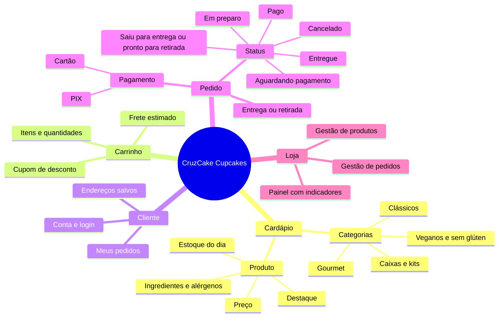

## 6.3 Mapa navegacional (mapa do app)

A vitrine (TELA-01) é o ponto central: o cabeçalho, presente em todas as telas, leva de volta a ela, ao carrinho e à conta.

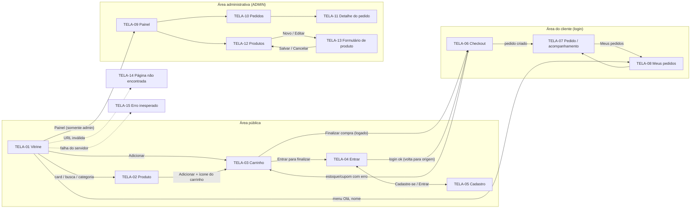

## 6.4 Especificação das telas (campos, validações e mensagens)

| Tela | Rota | Elementos principais | Validações e regras | Mensagens |
|---|---|---|---|---|
| TELA-01 Vitrine | `/` | Banner com cupom, busca, filtros por categoria (chips), grade de cards (2 colunas no celular, 4 no desktop) | Só produtos ativos (RN09); destaques primeiro | "Nenhum cupcake encontrado." + botão "Ver todos os sabores"; selos "Destaque", "Últimas N" |
| TELA-02 Produto | `/produto/[slug]` | Trilha de navegação, imagem, preço, descrição, ingredientes (expansível), seletor de quantidade, "Adicionar" | Quantidade entre 1 e o menor valor entre estoque e 24 (RN04) | "Esgotado hoje, volte amanhã!", "Últimas N unidades", "Disponível para hoje" |
| TELA-03 Carrinho | `/carrinho` | Lista de itens com +/−/Remover, cupom, resumo (subtotal, desconto, frete, total), "Finalizar compra" | Preço e estoque oficiais vêm do servidor; botão bloqueado se houver problema | "Temos apenas N unidade(s)…", "X esgotou.", "O cupom X está vencido.", "vale para compras a partir de R$…" |
| TELA-04 Entrar | `/entrar` | E-mail, senha, link para cadastro | E-mail válido; senha obrigatória | "E-mail ou senha incorretos." (não revela qual dos dois) |
| TELA-05 Cadastro | `/cadastro` | Nome, e-mail, celular (opcional), senha, confirmação | Nome 3–120; e-mail único; celular `(11) 91234-5678`; senha RN10; confirmação igual | "A senha deve conter pelo menos um número.", "As senhas não conferem.", "Já existe uma conta com este e-mail…" |
| TELA-06 Checkout | `/checkout` | 1. Entrega/Retirada + endereço (salvos ou novo com CEP); 2. PIX/Cartão; observações; resumo | CEP com 8 dígitos e busca no ViaCEP; UF com 2 letras; cartão Luhn/MM/AA/CVV (RN06) | "CEP não encontrado…", "Número de cartão inválido.", "Pagamento recusado pela operadora…", "X acabou de esgotar. Ajuste seu carrinho." |
| TELA-07 Pedido | `/pedidos/[id]` | Confirmação, bloco PIX (copia e cola, copiar, simular pagamento), cancelar, itens, entrega, pagamento, linha do tempo | Cancelar só antes do preparo (RN08); confirmação antes de cancelar | "Pedido #N recebido! 🎉", "Tem certeza que deseja cancelar…?", "Seu pedido já está em preparo e não pode mais ser cancelado…" |
| TELA-08 Meus pedidos | `/pedidos` | Lista com nº, data, quantidade, tipo, status colorido, total | Só pedidos do próprio cliente | "Você ainda não fez nenhum pedido." |
| TELA-09 Painel | `/admin` | Indicadores (em aberto, pagos, faturamento), estoque baixo | Somente ADMIN (cliente é redirecionado) | "Nenhum produto com estoque baixo." |
| TELA-10 Pedidos (admin) | `/admin/pedidos` | Filtro por situação, tabela de pedidos | | "Nenhum pedido nesta situação." |
| TELA-11 Detalhe (admin) | `/admin/pedidos/[id]` | Observação + botões apenas das próximas etapas válidas, dados do cliente, linha do tempo | Máquina de estados (RN07); cancelar pede confirmação e devolve estoque | "Não é possível mudar o pedido de 'Pagamento aprovado' para 'Entregue'.", "Este pedido está finalizado." |
| TELA-12 Produtos (admin) | `/admin/produtos` | Tabela com imagem, categoria, preço, estoque (cor por nível), situação, "Editar", "+ Novo produto" | | |
| TELA-13 Formulário de produto | `/admin/produtos/novo` e `/[id]` | Nome, categoria, preço (R$), estoque, descrição, ingredientes, imagem, ativo, destaque | Nome 3–100; descrição ≥ 10; preço > 0 e ≤ R$ 1.000; estoque ≥ 0; slug único gerado | "Selecione uma categoria.", "Informe um preço válido, ex.: 12,50", "Descrição deve ter pelo menos 10 caracteres." |
| TELA-14 Não encontrada | qualquer rota inválida | Ilustração, texto, "Voltar ao cardápio" | | "Página não encontrada" |
| TELA-15 Erro inesperado | (falha do servidor) | "Tentar de novo", "Ir para o cardápio" | O carrinho continua salvo | "Ops! Algo deu errado" |

### Catálogo de mensagens da API

Todas as respostas de erro da API seguem o formato `{ "erro": { "codigo", "mensagem", "campos" } }`, então o front mostra a mensagem geral e marca cada campo.

| Código | HTTP | Quando |
|---|---|---|
| VALIDACAO | 400 | Campo inválido (detalhado em `campos`) |
| NAO_AUTENTICADO | 401 | Ação exige login |
| CREDENCIAIS_INVALIDAS | 401 | Login incorreto |
| PAGAMENTO_RECUSADO | 402 | Cartão recusado |
| SEM_PERMISSAO | 403 | Cliente tentando ação de administrador |
| NAO_ENCONTRADO | 404 | Produto/pedido inexistente ou de outro cliente |
| EMAIL_JA_CADASTRADO, TRANSICAO_STATUS_INVALIDA, OPERACAO_NAO_PERMITIDA | 409 | Conflito com o estado atual |
| CARRINHO_VAZIO, PRODUTO_INDISPONIVEL, ESTOQUE_INSUFICIENTE, QUANTIDADE_INVALIDA, CUPOM_INVALIDO | 422 | Regra de negócio violada |
| ERRO_INTERNO | 500 | Falha inesperada ("Algo deu errado do nosso lado…") |

## 6.5 Wireframes (baixa fidelidade)

Esboços estruturais usados para validar a organização das telas antes do visual final (versão celular).

```
TELA-01 Vitrine              TELA-03 Carrinho              TELA-06 Checkout
┌──────────────────────┐    ┌──────────────────────┐     ┌──────────────────────┐
│ 🧁 Logo   Entrar [🛒3]│    │ 🧁 Logo   Entrar [🛒3]│     │ 🧁 Logo   Olá  [🛒3]  │
├──────────────────────┤    ├──────────────────────┤     ├──────────────────────┤
│ ┌──────────────────┐ │    │ Seu carrinho         │     │ Finalizar compra     │
│ │ BANNER + CUPOM   │ │    │ ┌──┐ Nome      R$ 00 │     │ 1. Como quer receber?│
│ └──────────────────┘ │    │ │im│ R$ x cada       │     │ (•) Entrega ( ) Ret. │
│ [🔍 Buscar sabores ] │    │ └──┘ [-] 2 [+] Remov.│     │ [CEP] [Rua........]  │
│ (Todos)(Clás)(Gour)→ │    │ ⚠ mensagem de erro   │     │ [Nº ] [Compl......]  │
│ ┌────────┐┌────────┐ │    │ ┌──┐ Nome      R$ 00 │     │ 2. Pagamento         │
│ │ imagem ││ imagem │ │    │ └──┘ [-] 1 [+] Remov.│     │ (•) PIX  ( ) Cartão  │
│ │ CATEG. ││ CATEG. │ │    ├──────────────────────┤     │ [Nº cartão.........] │
│ │ Nome   ││ Nome   │ │    │ Cupom [______][Aplic]│     │ [Validade] [CVV]     │
│ │ R$ 00  ││ R$ 00  │ │    │ Subtotal       R$ 00 │     │ Observações [______] │
│ │[Adicio]││[Adicio]│ │    │ Desconto      -R$ 00 │     ├──────────────────────┤
│ └────────┘└────────┘ │    │ Frete          R$ 00 │     │ Resumo  Total R$ 00  │
│ ...                  │    │ TOTAL          R$ 00 │     │ [ Confirmar pedido ] │
└──────────────────────┘    │ [ Finalizar compra ] │     └──────────────────────┘
                            └──────────────────────┘
TELA-07 Pedido               TELA-11 Pedido (admin)
┌──────────────────────┐    ┌──────────────────────────────────────────┐
│ ✓ Pedido #N recebido │    │ [Visão geral] [Pedidos] [Produtos]       │
│ ┌ Pague com PIX ───┐ │    │ Pedido #N                                │
│ │ [código.......]  │ │    │ Avançar etapa [observação.............]  │
│ │ [Copiar][Simular]│ │    │ [Marcar como "Em preparo"] [Cancelar]    │
│ └──────────────────┘ │    ├──────────────────────────┬───────────────┤
│ [Cancelar pedido]    │    │ Itens / valores          │ Acompanhamento│
│ Itens ... Total      │    │ Entrega / pagamento      │ ● Aguardando  │
│ Acompanhamento ●──●  │    │ Cliente                  │ ● Pago        │
└──────────────────────┘    └──────────────────────────┴───────────────┘
```

## 6.6 Mockups de alta fidelidade (aplicação real)

Capturas da aplicação em funcionamento, geradas automaticamente com `npm run telas` (script `scripts/capturar-telas.mjs`), que substituem os protótipos de média fidelidade do PIT I. Celular: 390 px de largura; desktop: 1280 px.

### Jornada do cliente (celular)

| Vitrine | Item adicionado (feedback) | Carrinho com erros de estoque e cupom |
|---|---|---|
| 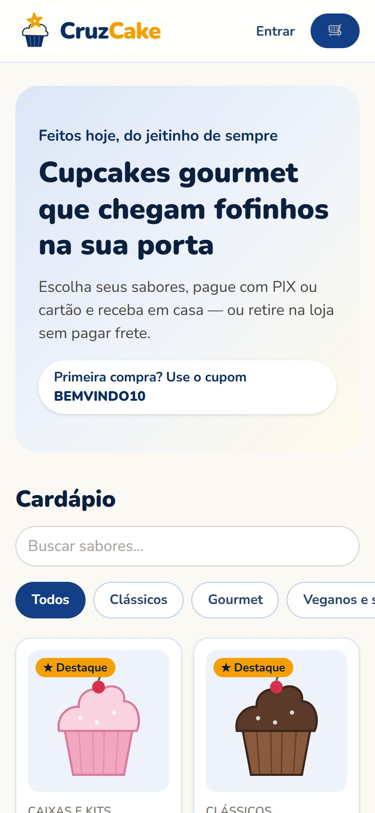 | 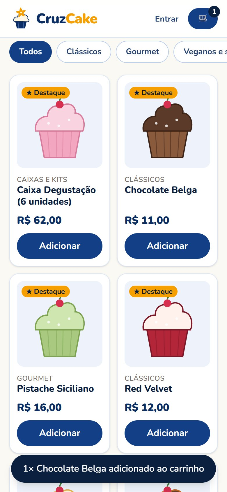 | 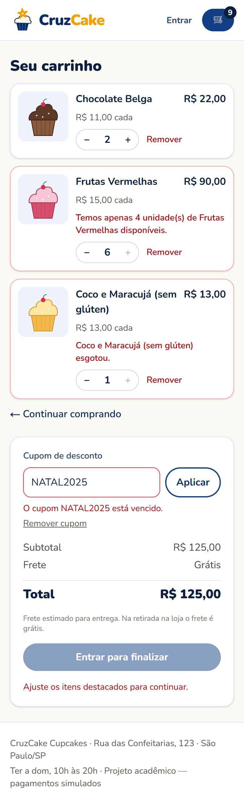 |

| Login com erro | Checkout (endereço salvo) | Resumo com cupom e retirada |
|---|---|---|
| 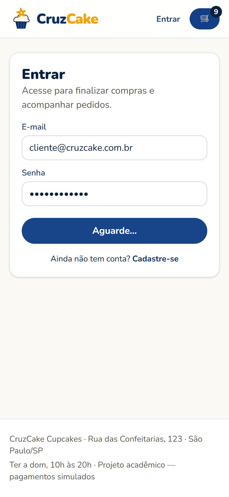 | 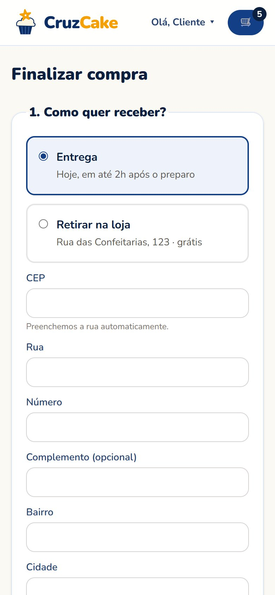 | 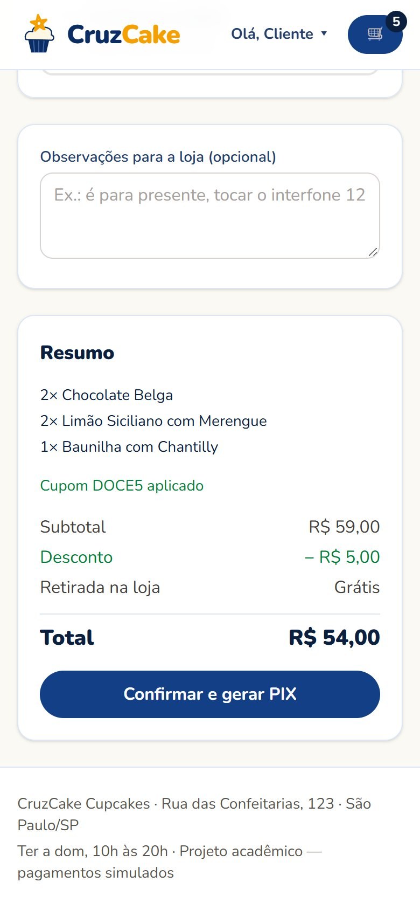 |

| Pedido aguardando PIX |
|---|
| 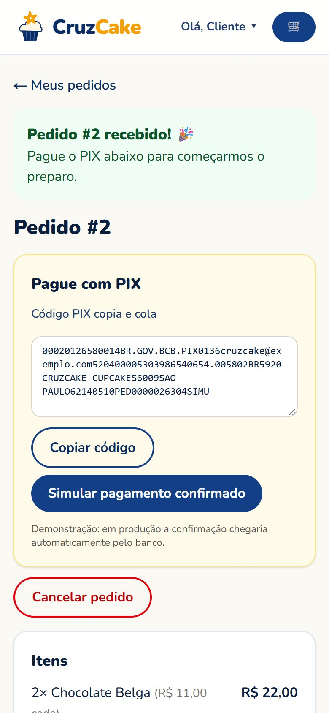 |

### Checkout no desktop

| Cartão recusado (mensagem de erro) | Pedido aprovado com linha do tempo |
|---|---|
| 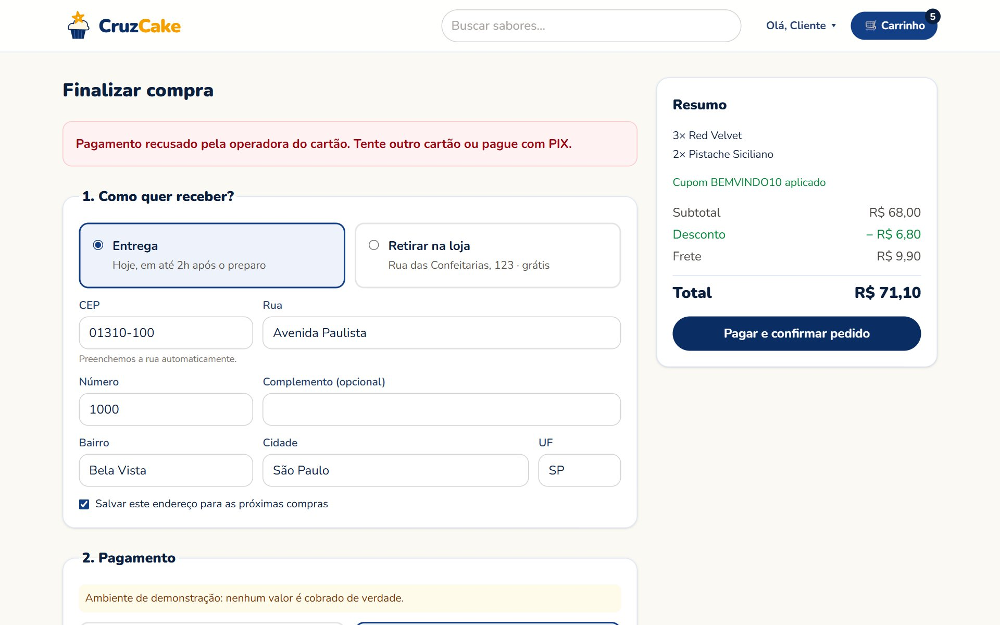 | 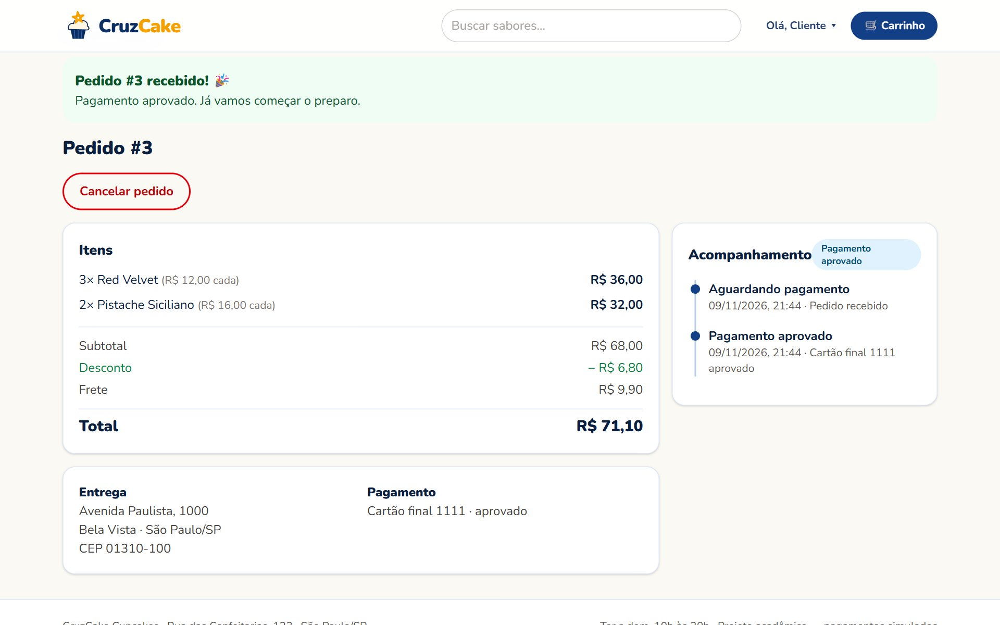 |

### Área administrativa (desktop)

| Painel | Pedidos |
|---|---|
| 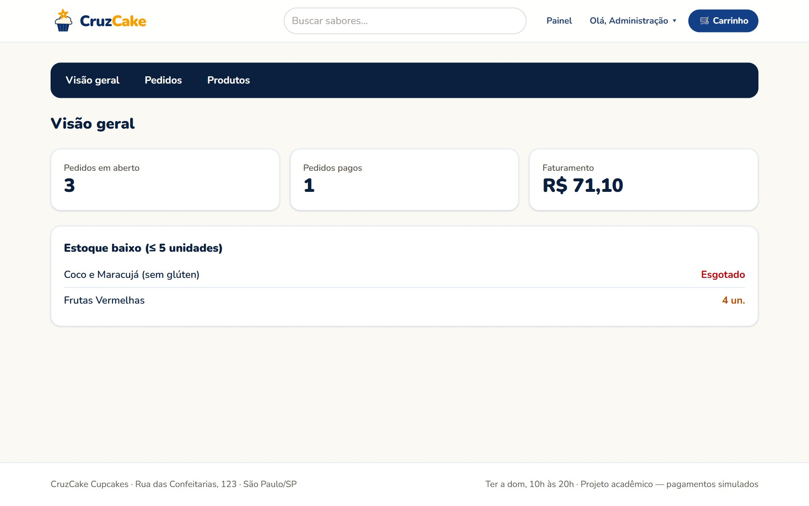 | 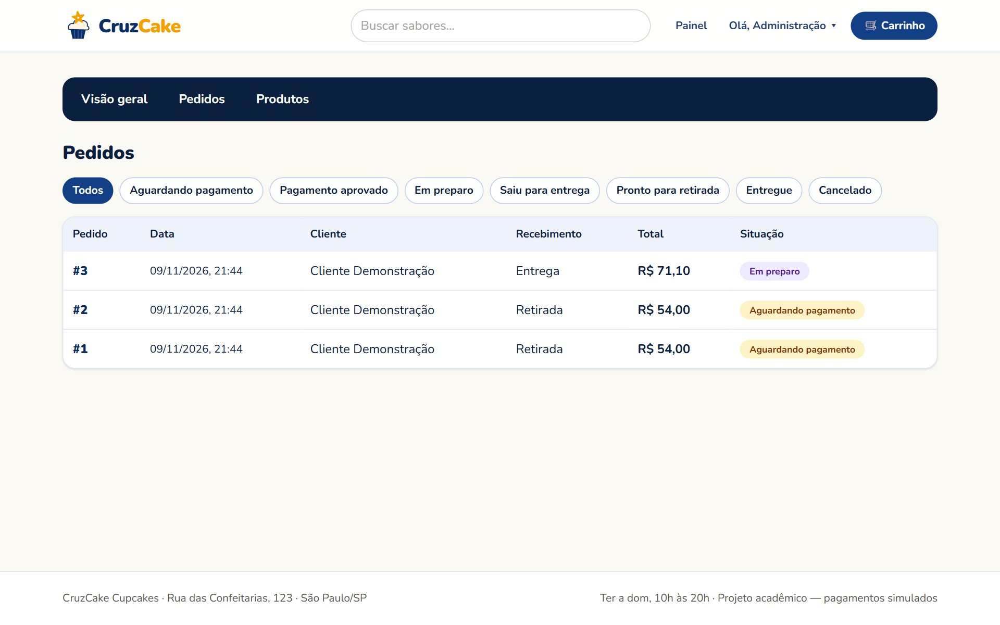 |

| Detalhe do pedido (próximas etapas válidas) | Produtos |
|---|---|
| 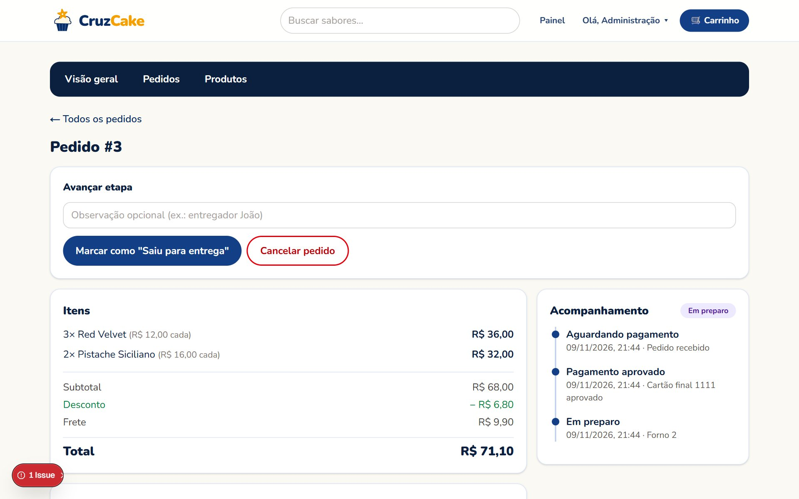 | 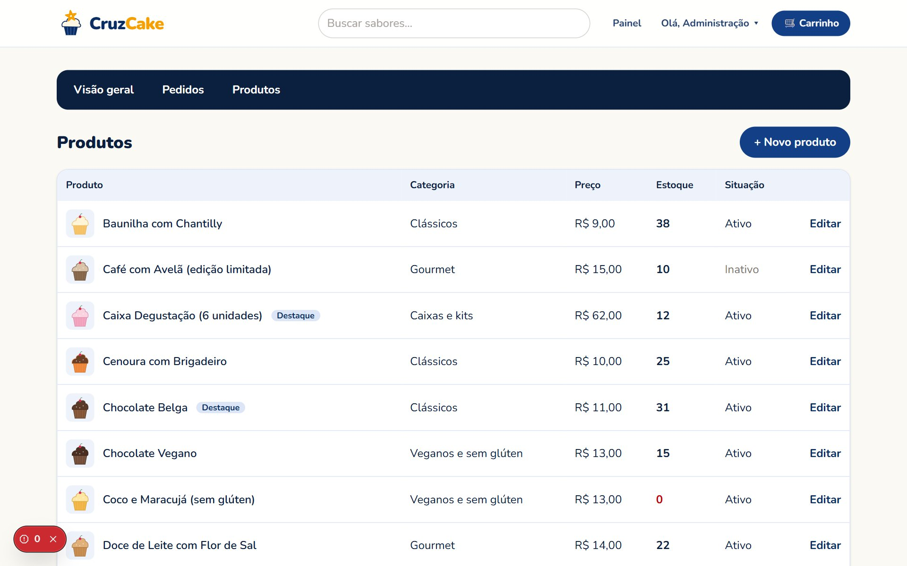 |

| Formulário de produto com validações |
|---|
| 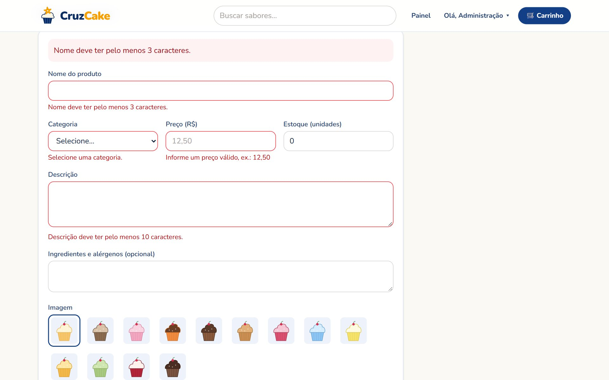 |
