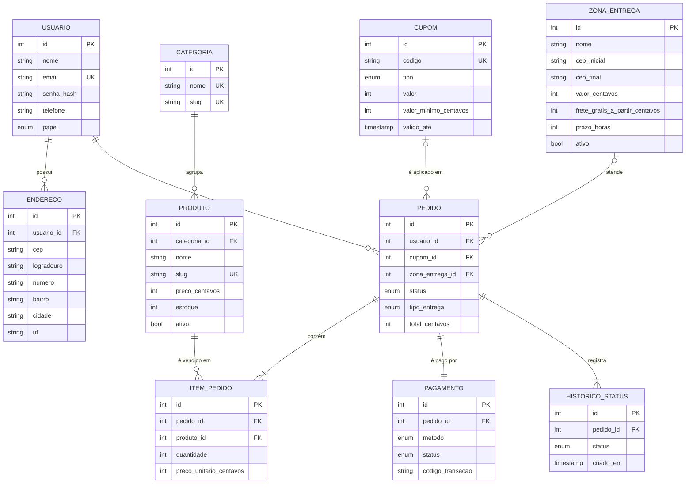

# 7. Modelagem de dados: conceitual, lógica e física

> Feita a partir do diagrama de classes de persistência (`05-diagramas-uml.md`, seção 5.1). SGBD escolhido: **PostgreSQL 16+**, popular, gratuito, com bom suporte a restrições (`CHECK`, `ENUM`) e oferecido por vários provedores gerenciados (Neon, Supabase, RDS).

## 7.1 Modelo conceitual (DER)



**Cardinalidades e regras extraídas das histórias**

| Relacionamento | Cardinalidade | Regra |
|---|---|---|
| Usuário — Pedido | 1 : N (0..N) | Um cliente pode ter vários pedidos; cada pedido tem exatamente um cliente |
| Pedido — Item | 1 : N (1..N) | Pedido sem item não existe (validado no checkout: carrinho vazio é recusado) |
| Produto — Item | 1 : N (0..N) | Um produto pode estar em vários pedidos; produto vendido não pode ser apagado (`ON DELETE RESTRICT`), apenas desativado (RN09) |
| Pedido — Pagamento | 1 : 1 | Cada pedido tem uma tentativa de pagamento registrada (`UNIQUE pedido_id`) |
| Cupom — Pedido | 0..1 : N | Pedido pode ter no máximo um cupom |
| Zona de entrega — Pedido | 0..1 : N | Só pedidos de entrega têm zona; a zona é a que cobre o CEP no momento da compra (RN02). Zonas não se relacionam com endereços: a ligação é calculada pela faixa de CEP |

## 7.2 Modelo lógico (relacional, normalizado)

Notação: **sublinhado** = chave primária, *itálico* = chave estrangeira.

- **usuarios** (<u>id</u>, nome, email, senha_hash, telefone, papel, criado_em)
- **enderecos** (<u>id</u>, *usuario_id*, apelido, cep, logradouro, numero, complemento, bairro, cidade, uf, criado_em)
- **categorias** (<u>id</u>, nome, slug, ordem)
- **produtos** (<u>id</u>, *categoria_id*, nome, slug, descricao, ingredientes, preco_centavos, estoque, imagem_url, ativo, destaque, criado_em, atualizado_em)
- **cupons** (<u>id</u>, codigo, tipo, valor, valor_minimo_centavos, valido_ate, ativo)
- **zonas_entrega** (<u>id</u>, nome, cep_inicial, cep_final, valor_centavos, frete_gratis_a_partir_centavos, prazo_horas, ativo, criado_em)
- **pedidos** (<u>id</u>, *usuario_id*, *cupom_id*, *zona_entrega_id*, status, tipo_entrega, entrega_cep, entrega_logradouro, entrega_numero, entrega_complemento, entrega_bairro, entrega_cidade, entrega_uf, subtotal_centavos, desconto_centavos, frete_centavos, total_centavos, observacao, criado_em, atualizado_em)
- **itens_pedido** (<u>id</u>, *pedido_id*, *produto_id*, nome_produto, preco_unitario_centavos, quantidade, subtotal_centavos)
- **pagamentos** (<u>id</u>, *pedido_id*, metodo, status, valor_centavos, codigo_transacao, pix_copia_e_cola, cartao_final, criado_em, atualizado_em)
- **historico_status_pedido** (<u>id</u>, *pedido_id*, status, observacao, criado_em)

### Verificação das formas normais

| Forma normal | Como é atendida |
|---|---|
| **1FN** | Todos os atributos são atômicos: o endereço é dividido em CEP, logradouro, número etc.; itens do pedido ficam em tabela própria, não em lista dentro do pedido |
| **2FN** | Todas as tabelas têm chave primária simples (`id`), então não há dependência parcial |
| **3FN** | Atributos não-chave dependem só da chave. Ex.: o nome da categoria fica em `categorias`, não repetido em `produtos`; dados do cliente ficam em `usuarios`, não no pedido |

### Desnormalizações intencionais (documentadas)

| Onde | Por quê |
|---|---|
| `itens_pedido.nome_produto` e `preco_unitario_centavos` | **Snapshot histórico**: se o produto mudar de nome ou preço, o pedido antigo continua mostrando o que o cliente comprou e pagou |
| `frete_centavos` em `pedidos` além de `zona_entrega_id` | O frete cobrado fica congelado; se a loja mudar o valor da zona depois, o pedido antigo não muda |
| Colunas `entrega_*` em `pedidos` | O endereço da entrega é um fato do pedido. Se o cliente editar ou apagar o endereço salvo, a entrega já feita não muda |
| `subtotal`, `desconto`, `frete`, `total` em `pedidos` e `subtotal_centavos` no item | Valores calculados e **congelados** no momento da compra (regras de frete e cupom podem mudar depois); também evitam recalcular em relatórios |

## 7.3 Modelo físico

O modelo físico é gerado a partir de `src/models/db/schema.ts` (ORM Drizzle) e versionado como migração SQL:

- DDL completo: [`database/migrations/0000_estrutura_inicial.sql`](../../database/migrations/0000_estrutura_inicial.sql) (estrutura inicial) e [`database/migrations/0001_zonas_de_entrega.sql`](../../database/migrations/0001_zonas_de_entrega.sql) (zonas de entrega e `pedidos.zona_entrega_id`, criada na revisão Kaizen)
- Dados iniciais (seed): [`database/seed.ts`](../../database/seed.ts)
- Dicionário de dados: [`database/dicionario-de-dados.md`](../../database/dicionario-de-dados.md)

### Domínios (tipos enumerados)

| Tipo | Valores |
|---|---|
| `papel_usuario` | CLIENTE, ADMIN |
| `status_pedido` | AGUARDANDO_PAGAMENTO, PAGO, EM_PREPARO, SAIU_PARA_ENTREGA, PRONTO_PARA_RETIRADA, ENTREGUE, CANCELADO |
| `tipo_entrega` | ENTREGA, RETIRADA |
| `metodo_pagamento` | PIX, CARTAO |
| `status_pagamento` | PENDENTE, APROVADO, RECUSADO |
| `tipo_cupom` | PERCENTUAL, VALOR_FIXO |

### Restrições de integridade (além de PK/FK e NOT NULL)

| Restrição | Tabela | Regra garantida no banco |
|---|---|---|
| `usuarios_email_uk` | usuarios | E-mail único |
| `produtos_slug_uk`, `categorias_slug_uk`, `categorias_nome_uk`, `cupons_codigo_uk` | várias | Identificadores únicos de URL e código de cupom |
| `produtos_preco_ck` | produtos | `preco_centavos > 0` |
| `produtos_estoque_ck` | produtos | `estoque >= 0`: o banco impede estoque negativo mesmo com acessos simultâneos (RN03) |
| `enderecos_cep_ck` | enderecos | CEP com exatamente 8 dígitos (`~ '^[0-9]{8}$'`) |
| `cupons_valor_ck`, `cupons_percentual_ck` | cupons | Valor positivo; percentual no máximo 100 |
| `itens_pedido_qtd_ck` | itens_pedido | Quantidade maior que zero |
| `pedidos_total_ck` | pedidos | Total não negativo |
| `pedidos_endereco_ck` | pedidos | Pedido de ENTREGA precisa ter CEP e logradouro |
| `zonas_cep_ck` | zonas_entrega | CEP inicial e final com 8 dígitos e `cep_inicial <= cep_final` |
| `zonas_valor_ck` | zonas_entrega | Frete `>= 0` (0 = sempre grátis) |
| `zonas_prazo_ck` | zonas_entrega | Prazo em horas `> 0` |
| `pagamentos_pedido_uk` | pagamentos | Um pagamento por pedido |

### Ações referenciais

| FK | Ação | Motivo |
|---|---|---|
| enderecos → usuarios | CASCADE | Endereços são apagados com o usuário |
| produtos → categorias | RESTRICT | Não se apaga categoria com produtos |
| pedidos → usuarios | RESTRICT | Histórico de vendas não pode sumir |
| pedidos → cupons | SET NULL | Cupom removido não apaga pedidos |
| pedidos → zonas_entrega | SET NULL | Zona removida não apaga pedidos (o frete cobrado continua gravado no pedido) |
| itens/pagamentos/histórico → pedidos | CASCADE | Partes do pedido (composição) |
| itens_pedido → produtos | RESTRICT | Produto já vendido é desativado, não excluído |

### Índices

| Índice | Uso |
|---|---|
| `produtos_categoria_idx` | Filtro da vitrine por categoria |
| `pedidos_usuario_idx` | Tela "Meus pedidos" |
| `pedidos_status_idx` | Filtro de pedidos por situação no painel |
| `itens_pedido_pedido_idx`, `historico_pedido_idx` | Montagem do detalhe do pedido |
| `enderecos_usuario_idx` | Endereços salvos no checkout |
| `zonas_faixa_idx` (cep_inicial, cep_final) | Busca da zona que cobre o CEP na cotação de frete |

### Como recriar o banco

```bash
npm run db:reset      # apaga o banco local, aplica migrações e seed
npm run db:generate   # gera nova migração após alterar src/models/db/schema.ts
```
