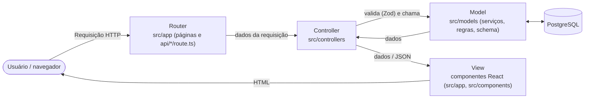

# Arquitetura e decisões técnicas

## Visão geral

Aplicação web **full stack em Next.js 16 (TypeScript)**, organizada no padrão **MVC**, com banco **PostgreSQL** acessado pelo ORM Drizzle.

| Item | Escolha |
|---|---|
| Linguagem | TypeScript (Node.js 22) em front-end e back-end |
| Framework | Next.js 16 (App Router), React 19 |
| Estilo | Tailwind CSS 4 (HTML + CSS utilitário), mobile-first |
| Banco de dados | PostgreSQL (produção) e PGlite, um PostgreSQL embarcado em WASM (desenvolvimento e testes) |
| Acesso a dados | Drizzle ORM + migrações SQL versionadas |
| Validação | Zod (contratos de entrada) |
| Autenticação | Senha com hash bcrypt + sessão JWT (HS256) em cookie `httpOnly` |
| Testes | Vitest (unitários e integração com banco real em memória) |
| Hospedagem sugerida | Vercel (aplicação) + Neon (PostgreSQL gerenciado) |
| Modo de codificação | Tradicional (código escrito à mão, sem low-code/no-code) |

## O padrão MVC neste projeto

O material da disciplina indica MVC com o fluxo **Usuário → Router → Controller ↔ Model → View → Usuário**. No Next.js esse fluxo fica assim:



| Camada | Pasta | Responsabilidade | Não pode |
|---|---|---|---|
| **Router** | `src/app/**/page.tsx`, `src/app/api/**/route.ts` | Mapear URL → controller; os *route handlers* têm 3–5 linhas | Conter regra de negócio |
| **Controller** | `src/controllers/*.controller.ts` | Validar entrada (`validacoes.ts`), checar sessão/permissão (`http.ts`), chamar o Model, traduzir erros para HTTP | Acessar o banco diretamente |
| **Model** | `src/models/` | `db/schema.ts` (entidades), `services/*` (casos de uso com banco/transações), `regras/*` (regras puras RN01–RN10), `erros.ts` | Conhecer HTTP, cookies ou React |
| **View** | `src/app/**` (JSX), `src/components/*` | Renderizar HTML, interação, estado do carrinho no navegador | Calcular preço oficial ou decidir regra de negócio |

**Exemplo de ponta a ponta (finalizar compra):**
`TelaCheckout.tsx` (View) → `POST /api/pedidos` (`app/api/pedidos/route.ts`, Router) → `pedido.controller.finalizarCompra` (valida com `checkoutSchema`, exige sessão) → `pedido.service.criarPedido` (transação: reprecifica, baixa estoque, autoriza pagamento, grava) → resposta JSON → View redireciona para a página do pedido.

### Estrutura de pastas

```
src/
├── app/                      # ROUTER + VIEW (páginas e rotas de API)
│   ├── page.tsx              # TELA-01 Vitrine
│   ├── produto/[slug]/       # TELA-02
│   ├── carrinho/             # TELA-03
│   ├── entrar/, cadastro/    # TELA-04/05
│   ├── checkout/             # TELA-06
│   ├── pedidos/              # TELA-07/08
│   ├── admin/                # TELA-09 a 13 (protegido por papel ADMIN)
│   ├── api/                  # REST: auth, produtos, carrinho, pedidos, admin
│   ├── not-found.tsx         # TELA-14
│   └── error.tsx             # TELA-15
├── components/               # VIEW: componentes reutilizáveis
├── controllers/              # CONTROLLER
│   ├── validacoes.ts         # contratos de entrada (Zod)
│   ├── http.ts               # erros padronizados, exigirSessao/exigirAdmin
│   └── *.controller.ts
├── models/                   # MODEL
│   ├── db/schema.ts          # entidades e restrições (fonte do modelo físico)
│   ├── db/client.ts          # conexão PostgreSQL/PGlite
│   ├── regras/               # regras de negócio puras (testes unitários)
│   ├── services/             # casos de uso com banco (testes de integração)
│   └── erros.ts
└── lib/                      # infraestrutura: sessão (JWT) e cliente HTTP do navegador
database/                     # migrações, seed, setup e dicionário de dados
tests/                        # unit/ e integration/
```

## API REST

| Método | Rota | Acesso | Descrição |
|---|---|---|---|
| POST | `/api/auth/cadastro` | público | Cria conta e já inicia sessão |
| POST | `/api/auth/entrar` | público | Login |
| POST | `/api/auth/sair` | público | Logout |
| GET | `/api/produtos?categoria=&busca=` | público | Vitrine (categorias + produtos ativos) |
| POST | `/api/carrinho/precificar` | público | Preço, estoque, cupom e frete oficiais do carrinho |
| GET | `/api/pedidos` | cliente | Meus pedidos |
| POST | `/api/pedidos` | cliente | Finalizar compra |
| GET | `/api/pedidos/{id}` | dono ou admin | Detalhe do pedido |
| POST | `/api/pedidos/{id}/confirmar-pix` | dono | Simula a confirmação do PIX |
| POST | `/api/pedidos/{id}/cancelar` | dono | Cancela (RN08) |
| GET/POST | `/api/admin/produtos` | admin | Lista / cria produto |
| PUT | `/api/admin/produtos/{id}` | admin | Edita produto |
| GET | `/api/admin/pedidos?status=` | admin | Lista pedidos |
| PATCH | `/api/admin/pedidos/{id}/status` | admin | Avança status (RN07) |

Erros: `{ "erro": { "codigo": "ESTOQUE_INSUFICIENTE", "mensagem": "…", "campos": { … } } }` (catálogo em `docs/situacao-1-planejamento/06-ihc.md`).

## Decisões de arquitetura (ADRs resumidos)

| # | Decisão | Alternativas consideradas | Motivo |
|---|---|---|---|
| ADR-01 | Web responsiva em vez de app nativo | React Native, Flutter, dois apps nativos | Uma base de código para todos os dispositivos, sem loja de apps; o público chega por links |
| ADR-02 | Next.js full stack em TypeScript | Front React + back Java/Python | O desenvolvedor tem mais experiência com JavaScript no back-end; uma linguagem só reduz o custo de manutenção; o enunciado lista linguagens *sugeridas* |
| ADR-03 | MVC explícito em pastas | Lógica direto nas páginas / *server actions* | Atende ao padrão indicado pela disciplina, facilita testes e deixa clara a separação de responsabilidades |
| ADR-04 | PostgreSQL + Drizzle | MySQL, MongoDB, Prisma | SGBD relacional popular; Drizzle gera SQL legível e migrações versionadas; o mesmo dialeto roda no PGlite |
| ADR-05 | PGlite em dev/teste | Docker com PostgreSQL, SQLite | Roda sem instalar nada (`npm run dev`) e mantém o comportamento do PostgreSQL (enums, CHECK, transações) nos testes |
| ADR-06 | Carrinho no navegador, preço no servidor | Carrinho persistido no banco | Visitante monta o carrinho sem login; segurança garantida porque o total é sempre recalculado no servidor |
| ADR-07 | Pagamento simulado isolado em `regras/pagamento.ts` | Integrar sandbox de gateway | Projeto acadêmico; a interface isolada permite trocar pelo gateway real sem mudar o resto do sistema |
| ADR-08 | Sessão JWT em cookie `httpOnly` | NextAuth, sessão em banco | Simples, sem dependência externa; o cookie não é acessível por JavaScript (mitiga XSS) |

## Segurança

- Senhas com **bcrypt** (custo 10); login com mensagem genérica (não revela se o e-mail existe).
- Cookie de sessão `httpOnly`, `sameSite=lax`, `secure` em produção, assinado com `SESSION_SECRET`.
- Autorização no **servidor** em todo controller (`exigirSessao`/`exigirAdmin`) e também no layout do admin; um cliente não vê pedido de outro cliente (retorna 404).
- Toda entrada validada com Zod; consultas parametrizadas pelo ORM (sem SQL concatenado).
- **Preço, desconto, frete e estoque nunca vêm do navegador**: são recalculados na transação do pedido.
- Baixa de estoque condicional (`WHERE estoque >= qtd`) + `CHECK (estoque >= 0)`: duas compras simultâneas não vendem o mesmo último cupcake.
- Dados de cartão não são armazenados (somente os 4 últimos dígitos).
- Redirecionamento pós-login aceita só caminhos internos (evita *open redirect*).

## Tratamento de erros

1. **Model** lança `ErroNegocio(codigo, mensagem, campos)`.
2. **Controller/`tratar()`** converte em JSON + status HTTP. Erros inesperados viram 500 com mensagem amigável (detalhe só no log do servidor).
3. **View** mostra a mensagem geral (`role="alert"`) e marca cada campo (`aria-invalid` + texto abaixo).
4. Páginas: `not-found.tsx` (404) e `error.tsx` (falha inesperada com "Tentar de novo").
