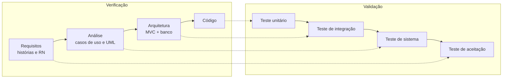

# Plano de Testes — CruzCake Cupcakes

> Situação-Problema 3 do PIT II: realizar e documentar os testes (verificação e validação), mostrando que o comportamento esperado foi atingido.

## 1. Objetivo

Garantir que a loja virtual atende às histórias de usuário e às regras de negócio (RN01 a RN10) definidas no planejamento. O plano tem duas frentes:

- **Verificação:** o software foi construído *corretamente*, ou seja, está de acordo com a especificação.
- **Validação:** foi construído o software *correto*, ou seja, o cliente e os usuários obtêm o produto que precisam.

## 2. Escopo

| Dentro do escopo | Fora do escopo |
|---|---|
| Vitrine, busca e filtro por categoria (TELA-01, TELA-02) | Integração com gateway de pagamento real (o pagamento é simulado, RN06) |
| Carrinho, cupom e cálculo de frete (TELA-03) | Testes de carga e estresse |
| Cadastro, login e logout (TELA-04, TELA-05) | Envio de e-mails e notificações |
| Checkout com entrega/retirada, PIX e cartão (TELA-06) | Emissão de nota fiscal |
| Acompanhamento e cancelamento de pedidos (TELA-07, TELA-08) | |
| Painel administrativo: indicadores, pedidos e produtos (TELA-09 a TELA-13) | |
| Tratamento de erros, mensagens, acessibilidade básica e responsividade | |

## 3. Estratégia: Verificação × Validação

| | Verificação | Validação |
|---|---|---|
| Pergunta | "Estamos construindo o produto corretamente?" | "Estamos construindo o produto certo?" |
| Quando | Durante o desenvolvimento | Após concluir um módulo ou o sistema |
| Como neste projeto | Revisão do código contra as regras de negócio, tipagem estática (TypeScript), lint (ESLint), testes unitários e de integração automatizados | Testes de sistema manuais seguindo os casos de teste e testes de aceitação com 5 usuários reais (colegas/profissionais) |
| Evidência | Saída do `npm test`, `npm run typecheck`, `npm run lint` e build | Casos de teste preenchidos, fichas dos testadores, prints e laudo de qualidade |

## 4. Níveis de teste no Modelo V



| Nível (lado esquerdo ↔ direito) | O que é testado neste projeto | Como | Onde |
|---|---|---|---|
| **Código ↔ Teste unitário** | Regras puras do Model: frete, cupom, totais, máquina de estados, cancelamento, pagamento simulado (Luhn, validade, CVV, recusa), PIX, utilitários de dinheiro e texto. Também os contratos de validação do Controller (Zod) | Vitest, automatizado | `tests/unit/*.test.ts` |
| **Arquitetura ↔ Teste de integração** | Serviços do Model rodando contra um **PostgreSQL real em memória (PGlite)**, com as mesmas migrações de produção: autenticação, vitrine, carrinho, checkout transacional (rollback), estoque, PIX, cancelamento, permissões e painel admin | Vitest + PGlite, automatizado | `tests/integration/*.test.ts` |
| **Análise ↔ Teste de sistema** | Fluxos ponta a ponta no navegador, passando por View → Controller → Model → banco, incluindo mensagens de erro, responsividade e teclado | Roteiro manual | [02-casos-de-teste-manuais.md](02-casos-de-teste-manuais.md) |
| **Requisitos ↔ Teste de aceitação** | Se a solução atende às necessidades de quem compra e de quem administra a loja | 5 testadores reais usando o app publicado e preenchendo o formulário | [03-formulario-teste-usuarios.md](03-formulario-teste-usuarios.md), [04-fichas-dos-testadores.md](04-fichas-dos-testadores.md) |

## 5. Ferramentas e ambiente

| Item | Ferramenta/versão |
|---|---|
| Framework de testes | Vitest 5 |
| Banco nos testes | PGlite (PostgreSQL compilado para WASM), criado em memória a cada teste, com `database/migrations` aplicadas e o seed carregado |
| Análise estática | TypeScript (`npm run typecheck`) e ESLint (`npm run lint`) |
| Testes manuais | Chrome/Edge no desktop e um celular Android/iOS (ou o modo dispositivo do DevTools) |
| Ambiente de sistema/aceitação | Aplicação publicada (Vercel + PostgreSQL) ou local (`npm run dev`, http://localhost:3000) |
| Coleta de feedback | Google Forms com upload de prints |
| Registro de evidências | Pasta [`evidencias/`](evidencias/README.md) |

**Dados de teste** (criados pelo seed, `database/seed.ts`):

| Tipo | Valor |
|---|---|
| Cliente | `cliente@cruzcake.com.br` / `Cliente1234` |
| Administrador | `admin@cruzcake.com.br` / `Admin1234` |
| Cartão aprovado | `4111 1111 1111 1111`, validade futura, CVV `123` |
| Cartão recusado | `4000 0000 0002 0000` (válido no Luhn, recusado pelo "emissor" simulado) |
| CEP | `01310-100` (Av. Paulista, preenchido via ViaCEP) |
| Cupons | `BEMVINDO10` (10%, mínimo R$ 30), `DOCE5` (R$ 5, mínimo R$ 40), `NATAL2025` (vencido) |
| Estoque | *Frutas Vermelhas* com 4 un.; *Coco e Maracujá* esgotado; *Café com Avelã* inativo |

## 6. Critérios de entrada e saída

**Entrada (para iniciar os testes de sistema/aceitação):**
- build de produção (`npm run build`) sem erros;
- `npm run typecheck` e `npm run lint` sem erros;
- 100% dos testes automatizados passando;
- banco com o seed aplicado e app acessível pela URL de teste.

**Saída (para considerar a versão aprovada):**
- 100% dos testes automatizados passando;
- todos os casos de teste manuais executados, sem defeitos *Bloqueantes* ou *Altos* em aberto;
- 5 fichas de testadores recebidas e analisadas;
- cada defeito classificado como corrigido (com commit e reteste) ou como pendência justificada no laudo.

## 7. Como executar os testes automatizados

```bash
npm install
npm test            # executa unitários + integração uma vez
npm run test:watch  # modo interativo durante o desenvolvimento
npm run typecheck   # verificação de tipos
npm run lint        # análise estática
```

Os testes não precisam de banco instalado, porque cada teste de integração cria um PostgreSQL em memória.

## 8. Resultado atual da execução automatizada

Execução em 09/11/2026: **4 arquivos, 52 testes, 52 passando, 0 falhas.**

| Arquivo | Grupo (`describe`) | Testes |
|---|---|---|
| `tests/unit/regras-pedido.test.ts` | RN02 — frete | 3 |
| | RN05 — cupom de desconto | 7 |
| | RN01 — totais | 2 |
| | RN07 — máquina de estados do pedido (inclui RN08) | 5 |
| `tests/unit/regras-pagamento.test.ts` | RN06 — pagamento simulado com cartão | 6 |
| | PIX simulado | 1 |
| | utilitários | 3 |
| `tests/unit/validacoes.test.ts` | Validação de entrada (Controller) | 6 |
| `tests/integration/pedido.service.test.ts` | Autenticação | 3 |
| | Vitrine | 3 |
| | Carrinho | 3 |
| | Checkout e ciclo do pedido | 8 |
| | Administração | 2 |
| **Total** | | **52** |

Para anexar como evidência, salve a saída do terminal em `evidencias/TESTES-AUTOMATIZADOS_saida.png` (print) ou `.txt`.

## 9. Matriz de rastreabilidade

A coluna HU indica o tema da história de usuário. Os IDs exatos estão no backlog em `docs/situacao-1-planejamento`.

| Regra / requisito | HU (tema) | Testes automatizados (nome do teste) | Caso manual |
|---|---|---|---|
| **RN01** Totais em centavos (total = subtotal − desconto + frete) | HU (Carrinho / Checkout) | "total = subtotal − desconto + frete"; "frete grátis é avaliado depois do desconto"; "recalcula preços no servidor e aplica cupom"; "formata centavos em reais"; "converte texto em reais para centavos" | CT-02, CT-06 |
| **RN02** Frete fixo R$ 9,90, grátis a partir de R$ 120, retirada sem frete | HU (Entrega) | "retirada na loja não cobra frete"; "entrega abaixo de R$ 120 cobra frete fixo"; "entrega a partir de R$ 120 tem frete grátis"; "entrega exige endereço; retirada não cobra frete" | CT-06, CT-11 |
| **RN03** Estoque: não vender acima do disponível, baixa na compra, devolução no cancelamento | HU (Estoque / Checkout) | "aponta produto esgotado e quantidade acima do estoque"; "não vende acima do estoque"; "pedido com cartão aprovado nasce PAGO, baixa estoque e registra histórico"; "cartão recusado não cria pedido nem baixa estoque (rollback)"; "cancelamento pelo cliente devolve o estoque; após preparo não pode cancelar" | CT-01, CT-09, CT-10, CT-13 |
| **RN04** Limite de 24 unidades por item | HU (Carrinho) | "recusa carrinho vazio e quantidade acima do limite" | CT-10 |
| **RN05** Cupom: ativo, dentro da validade, valor mínimo, desconto ≤ subtotal | HU (Promoções) | 7 testes do grupo "RN05 — cupom de desconto"; "informa cupom vencido sem quebrar o carrinho" | CT-07, CT-08 |
| **RN06** Pagamento simulado (Luhn, validade, CVV, recusa terminada em 0000, PIX) | HU (Pagamento) | 6 testes do grupo "RN06 — pagamento simulado com cartão"; "gera código copia-e-cola com o valor do pedido"; "PIX: pedido aguarda pagamento e é liberado na confirmação"; "checkout com entrega exige endereço e cartão exige dados" | CT-01, CT-02, CT-12 |
| **RN07** Máquina de estados do pedido | HU (Gestão de pedidos) | 4 testes do grupo "RN07"; "fluxo completo da loja até a entrega" | CT-03, CT-04, CT-14 |
| **RN08** Cliente só cancela antes do preparo | HU (Acompanhamento do pedido) | "RN08 — cliente só cancela antes do preparo"; "cancelamento pelo cliente devolve o estoque; após preparo não pode cancelar" | CT-13 |
| **RN09** Só produtos ativos na vitrine | HU (Vitrine / Gestão de produtos) | "lista apenas produtos ativos, com destaques primeiro"; "produto inativo não abre a página de detalhe" | CT-05, CT-16 |
| **RN10** Senha com 8+ caracteres, letras e números | HU (Cadastro) | "RN10 — exige senha com letras e números"; "aponta confirmação de senha diferente no campo correto" | CT-17 |
| Cadastro, login e e-mail único | HU (Conta do cliente) | "cadastra usuário com senha criptografada e permite login"; "impede e-mail duplicado"; "recusa senha errada com mensagem genérica" | CT-18 |
| Privacidade e permissão de acesso | HU (Conta / Administração) | "cliente não enxerga pedido de outro cliente" | CT-15 |
| Busca e filtro da vitrine | HU (Vitrine) | "filtra por categoria e por busca" | CT-05 |
| Painel administrativo | HU (Administração) | "cria produto com slug único"; "resumo do painel soma apenas pedidos pagos" | CT-14, CT-16 |
| Endereço (CEP/UF normalizados) | HU (Entrega) | "normaliza CEP e UF do endereço" | CT-02 |
| Usabilidade, acessibilidade, responsividade e persistência do carrinho | HU (Experiência do usuário) | (não automatizado) | CT-19, CT-20, CT-21, CT-22 |
